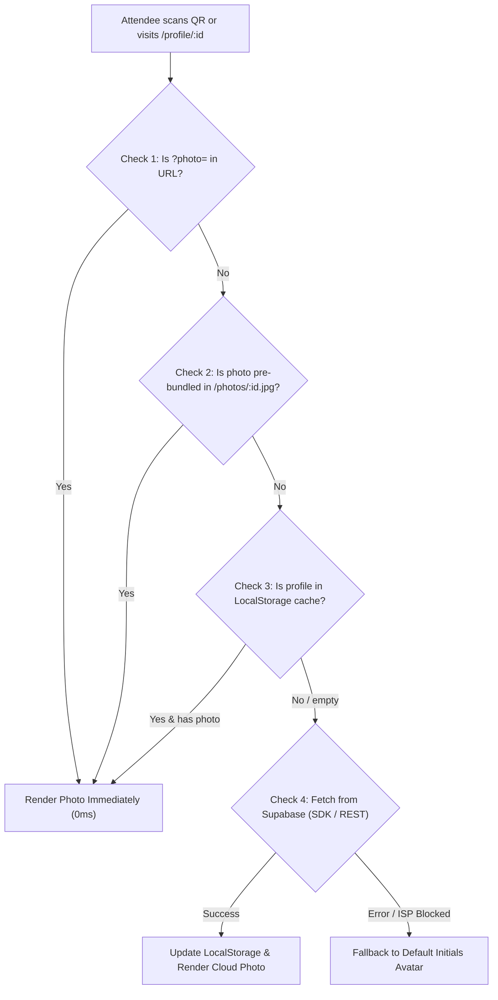

# 🎓 AHS CELEBRATION 2026 — Digital Invitation & Pass System

[](https://react.dev/)
[](https://www.typescriptlang.org/)
[](https://vitejs.dev/)
[](https://supabase.com/)
[](https://ahs-celebration.vercel.app/)

> **KRISHNA COLLEGE OF PARAMEDICAL AND ALLIED HEALTH SCIENCE**  
> **DEPARTMENT OF ALLIED HEALTH SCIENCES (AHS)**  
> *Freshers Day & Farewell Day 2026 — Celebrating New Beginnings • Cherishing Memories*

---

## 🌐 Live Production Access

- **Public Event Portal:** [https://ahs-celebration.vercel.app](https://ahs-celebration.vercel.app)
- **Sample Verified Invitation:** [https://ahs-celebration.vercel.app/profile/sowndariya](https://ahs-celebration.vercel.app/profile/sowndariya)
- **Administrative Dashboard:** [https://ahs-celebration.vercel.app/admin](https://ahs-celebration.vercel.app/admin)
  - **Passcode:** `admin@radio`

---

## 📖 Project Overview

**AHS Celebration 2026** is a high-performance, mobile-first web application developed for the Department of Allied Health Sciences at Krishna College of Paramedical and Allied Health Science.

It serves as the official event companion platform for **Freshers Day & Farewell Day 2026**, offering:
1. **Interactive Event Gateway:** Live countdown timer, searchable attendee roster, and theme-adaptive ambient backgrounds.
2. **Official Personalized Invitations (`/profile/:id`):** Pixel-perfect digital posters overlaid on official institutional design templates with attendee portrait frames, custom typography ribbons, register numbers, and personalized invitations.
3. **Verifiable Digital QR Passes:** Unique QR codes generated for every attendee, allowing instant verification and pass download.
4. **Admin Control Room (`/admin`):** Password-gated attendee management suite with photo uploads, live database sync, and one-click QR pass distribution.

---

## 🏛️ System Architecture & Multi-Layer Photo Pipeline

One critical technical challenge in campus event applications in India is that mobile networks (e.g., Reliance Jio, Airtel 5G) frequently block or throttle direct requests to third-party cloud subdomains (like `*.supabase.co`).

To guarantee **100% uptime and instant 0ms rendering on all mobile phones**, this platform implements a **4-tier fault-tolerant photo resolution pipeline**:



### Photo Loading Fallback Layers:
1. **Tier 1 — Same-Origin Static Bundle (`/photos/*.jpg`):** Pre-optimized attendee photos stored in `public/photos/` and served directly from the Vercel Edge CDN (`https://ahs-celebration.vercel.app/photos/...`). Immune to mobile carrier DNS blocks.
2. **Tier 2 — Supabase Public Cloud Storage:** Uploaded directly from Admin Dashboard to the `photos` public storage bucket.
3. **Tier 3 — Native REST API Fallback:** If the `@supabase/supabase-js` client is blocked by browser extensions, the app falls back to standard HTTP REST requests.
4. **Tier 4 — URL Query Parameter:** QR passes embed `&photo=...` directly into the encoded URL for instant cross-device sharing.

---

## 🎨 Design & Aesthetic Foundations

- **Dual Event Themes:**
  - **Freshers Day:** Electric Cyan / Neon Blue palette (`#42D9FF`, `#00F0FF`, `#020610`), medical ECG pulse lines, X-Ray & CT scan iconography.
  - **Farewell Day:** Regal Violet / Purple palette (`#C084FC`, `#A855F7`, `#070210`), graduation caps, laurels, and warm celebratory glows.
- **Glassmorphism & Depth:** Backdrop blur filters, layered radial gradients, micro-animations, and subtle hover lifts.
- **Official Poster Overlay Engine (`OfficialInvitation.tsx`):** High-resolution institutional artwork (`public/templates/freshers-template.jpg` and `farewell-template.jpg`) overlaid with dynamically positioned CSS coordinates:
  - Exact center circular portrait slot with laurel wreath border.
  - Script font name ribbon.
  - Reg. No. pill badge.
  - Personalized salutation text block.
  - Web Share API and PDF / Print layout stylesheets (`@media print`).

---

## 📂 Project Directory Structure

```text
Farewell/
├── public/
│   ├── images/
│   │   ├── farewell/            # Farewell senior images
│   │   └── freshers/            # Freshers batch images
│   ├── photos/                  # High-availability same-origin attendee photos
│   ├── templates/
│   │   ├── farewell-template.jpg # Official Farewell Invitation design
│   │   └── freshers-template.jpg # Official Freshers Invitation design
│   ├── favicon.svg
│   └── icons.svg
├── src/
│   ├── components/
│   │   ├── Aurora.tsx           # Multi-layered fluid aurora background ribbons
│   │   ├── EventBackground.tsx  # Dynamic ambient gradient container
│   │   ├── EventBadge.tsx       # Reusable cyan/purple event type pill
│   │   ├── GridMotion.tsx       # Kinetic photo grid animation
│   │   ├── Hero.tsx             # Home hero section with live countdown
│   │   ├── InvitationCard.tsx   # Compact preview invitation card
│   │   ├── OfficialInvitation.tsx# Full official poster card with precise overlays
│   │   ├── ProfileCard.tsx      # Attendee grid card with photo & QR triggers
│   │   ├── ProfileSearch.tsx    # Live debounce search bar with filter tabs
│   │   └── QRCodeCard.tsx       # Dedicated modal with canvas QR generator
│   ├── data/
│   │   └── profiles.ts          # State management, Supabase sync, fallback maps
│   ├── lib/
│   │   └── supabase.ts          # Supabase client instantiation & fallback config
│   ├── pages/
│   │   ├── Admin.tsx            # Full administrative dashboard & roster editor
│   │   ├── Home.tsx             # Main event gateway & roster browser
│   │   └── Profile.tsx          # Dedicated attendee personalized pass view
│   ├── App.tsx                  # React Router routes setup
│   ├── index.css                # Global CSS variables & typography tokens
│   └── main.tsx                 # React DOM root entry
├── vercel.json                  # Vercel SPA rewrites & routing rules
├── vite.config.ts               # Vite build configuration
├── package.json                 # Project dependencies & build scripts
└── README.md                    # Comprehensive technical documentation
```

---

## 🗄️ Database Schema & Supabase Configuration

### 1. `profiles` Table Schema

Run the following SQL in your Supabase SQL Editor if setting up a new environment:

```sql
-- Create profiles table
CREATE TABLE IF NOT EXISTS public.profiles (
  id TEXT PRIMARY KEY,
  name TEXT NOT NULL,
  reg_no TEXT,
  event_type TEXT DEFAULT 'freshers' CHECK (event_type IN ('freshers', 'farewell')),
  photo TEXT DEFAULT '',
  role TEXT DEFAULT '',
  quote TEXT DEFAULT '',
  created_at TIMESTAMPTZ DEFAULT TIMEZONE('utc', NOW())
);

-- Enable Row Level Security (RLS)
ALTER TABLE public.profiles ENABLE ROW LEVEL SECURITY;

-- Allow anonymous public reads (so anyone scanning QR can read attendee data)
CREATE POLICY "Public Read Profiles"
ON public.profiles
FOR SELECT
TO anon, authenticated
USING (true);

-- Allow authenticated or public inserts/updates (managed via admin portal)
CREATE POLICY "Public Insert Profiles"
ON public.profiles
FOR INSERT
TO anon, authenticated
WITH CHECK (true);

CREATE POLICY "Public Update Profiles"
ON public.profiles
FOR UPDATE
TO anon, authenticated
USING (true);

CREATE POLICY "Public Delete Profiles"
ON public.profiles
FOR DELETE
TO anon, authenticated
USING (true);
```

### 2. `photos` Storage Bucket Setup

1. In Supabase Dashboard, navigate to **Storage** → **New Bucket**.
2. Name the bucket: **`photos`**.
3. Toggle **Public Bucket** to **ON**.
4. Under **Storage Policies**, enable public `SELECT`, `INSERT`, `UPDATE`, and `DELETE` permissions for anonymous users.

---

## ⚙️ Environment Variables

Create a `.env` file in the project root:

```env
# Supabase Configuration
VITE_SUPABASE_URL=https://fkunjtrdccsuslaefdch.supabase.co
VITE_SUPABASE_ANON_KEY=sb_publishable_w6JySw5FJpVUaoYsmYrOPw__gSWywyo
```

*(Note: Production builds also contain hardcoded production fallbacks in [`src/lib/supabase.ts`](src/lib/supabase.ts) to guarantee zero deployment failures even if env vars are omitted in a hosting environment).*

---

## 🛠️ Local Development & Scripts

### Prerequisites
- **Node.js**: v18.0.0 or higher
- **npm** or **yarn**

### 1. Installation
```bash
git clone https://github.com/Sibiraj-003/AHS-CELEBRATION.git
cd AHS-CELEBRATION
npm install
```

### 2. Run Local Development Server
```bash
npm run dev
```
Open [http://localhost:5173](http://localhost:5173) in your browser.

### 3. Production Build & Type Check
```bash
npm run build
```
Generates an optimized production bundle in the `dist/` directory.

### 4. Preview Production Build Locally
```bash
npm run preview
```

---

## 🔐 Administrative Dashboard Guide (`/admin`)

- **URL:** `/admin`
- **Security:** Protected by client-side gate checking session token with password: `admin@radio`.
- **Features:**
  - **Add Attendee:** Auto-generates URL slug and uppercase register number from name.
  - **Photo Optimization & Upload:** Uploads image directly to Supabase Storage bucket and stores public URL.
  - **Quick Upload from Roster Table:** Directly upload / replace photo from table row.
  - **QR Pass Generator Modal:** Generates high-resolution QR canvas, preview URL, and allows 1-click **Download QR PNG** or **Copy Link**.
  - **Bulk Management:** Clear all photos or clear all attendee data with one click.

---

## 🚢 Deployment (Vercel)

The repository is configured for automated Continuous Deployment via **Vercel**:
- **Branch:** `main`
- **Build Command:** `npm run build`
- **Output Directory:** `dist`
- **SPA Rewrites:** Configured via [`vercel.json`](vercel.json):
  ```json
  {
    "rewrites": [
      {
        "source": "/(.*)",
        "destination": "/index.html"
      }
    ]
  }
  ```

---

## 🤝 Contributing & Maintenance Checklist

When adding new attendees or updating features:
1. If uploading photos in bulk, add images to `public/photos/<id>.jpg` and run `npm run build`.
2. Ensure new attendee slugs match alphanumeric lowercase format (`kabeer-khan`, `sowndariya`).
3. Always verify changes using `npm run build` prior to pushing to `origin main`.

---

## 📄 License & Credits

- **Event:** AHS Celebration 2026 (Freshers Day & Farewell Day)
- **Institution:** Krishna College of Paramedical and Allied Health Science
- **Department:** Department of Allied Health Sciences (AHS)
- **Engineered By:** Sibiraj & Team
